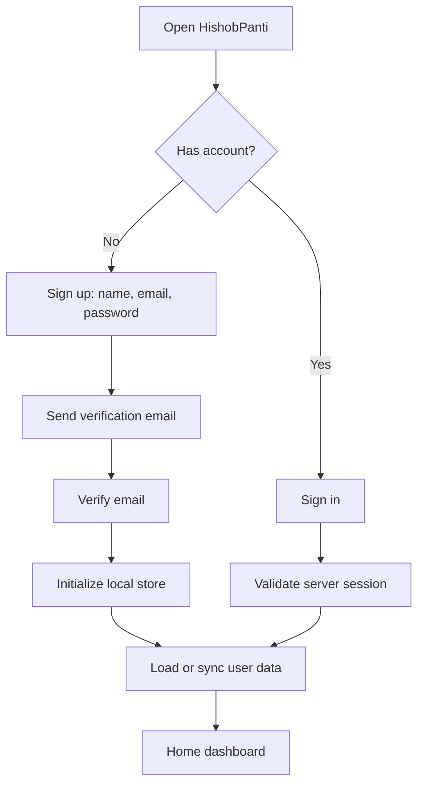
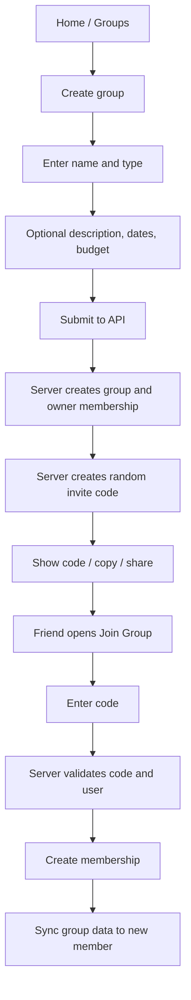
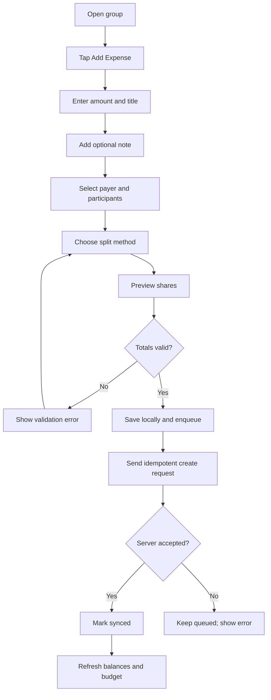
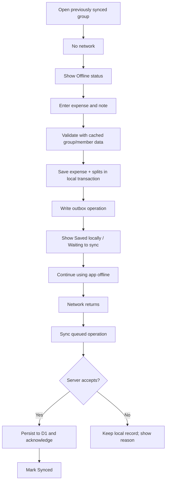
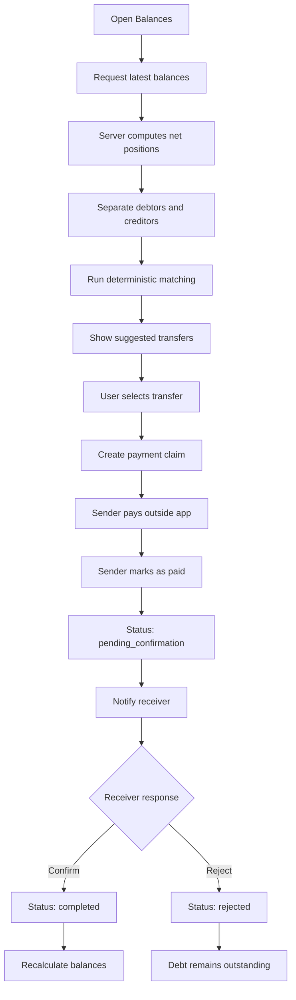
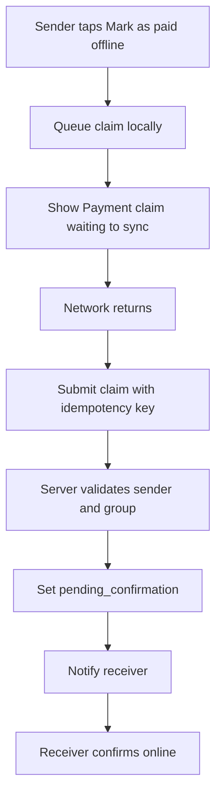
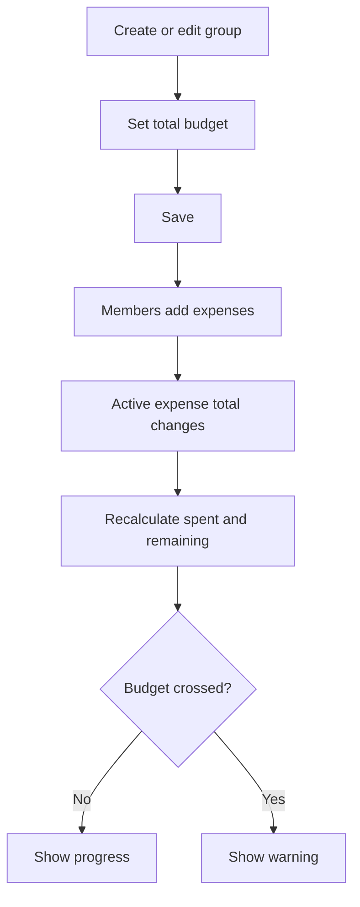

# 02 — User Workflows

**Product:** HishobPanti · **Version:** 1.0

The server is authoritative for membership, synchronized financial records, and settlement completion.

## 1. Sign up / sign in

Authentication requires internet. Previously authenticated users may view cached data offline subject to session-expiry policy. Never store plaintext passwords.

## 2. Create group and invite members

Group creation and joining require internet. Store only a secure hash of invite code. Codes are credentials, not public group IDs. Apply expiry, revocation, use limits, and rate limiting.

## 3. Add expense online

Fields: title, amount, payer, participants, split method, category, date/time, optional note, optional receipt (P1). Payer can also be a participant. Split must total the expense exactly.

## 4. Add expense offline

Constraints: only previously synced groups and members are available offline. Local balances are provisional. A local expense is not visible to other members until synchronized. Membership may have changed while offline; server validation decides whether the operation can be accepted.

## 5. Smart settlement

A suggestion is not a payment. Only the intended receiver may confirm or reject. Sender cannot confirm on behalf of receiver.

## 6. Sender marks paid while offline

Do not show “Paid” or “Completed” while action is local-only.

## 7. Receiver confirms or rejects

Receiver sees sender, amount, currency, group, claim date, optional payment method/reference and two actions: “I received it” or “I did not receive it”. Confirmation conditionally changes server state from `pending_confirmation` to `completed`; rejection changes it to `rejected`. Duplicate responses are idempotent. Rejected payments remain outstanding.

## 8. Trip budget

Budget usage is active expense totals, not settlement payments.

## 9. Edit/conflict workflow

- Each mutable expense has a server version integer.
- Client sends the version it last read.
- If current, server accepts and increments version.
- If stale, return a conflict and preserve the local edit.
- Show latest server version and local draft for review.
- Do not silently overwrite newer financial records.
- Voiding is a recorded state change, not hard deletion.

## 10. Offline/cloud backup workflow

Local storage preserves pending work on that device. Once synced, D1 becomes authoritative. Scheduled D1 exports go to a private R2 backup bucket. Recovery must be tested in a non-production environment. App deletion/device loss may remove unsynchronized local entries.

## 11. User-facing sync/payment labels

| Situation | Label |
|---|---|
| Local expense saved | Saved locally · Waiting to sync |
| Upload in progress | Syncing |
| Server acknowledged | Synced |
| Sync error | Sync failed · Retry |
| Offline payment claim | Payment claim waiting to sync |
| Claim received by server | Awaiting receiver confirmation |
| Receiver confirms | Payment confirmed |
| Receiver rejects | Payment not received |
| Suggestion only | Suggested transfer · Not paid |
