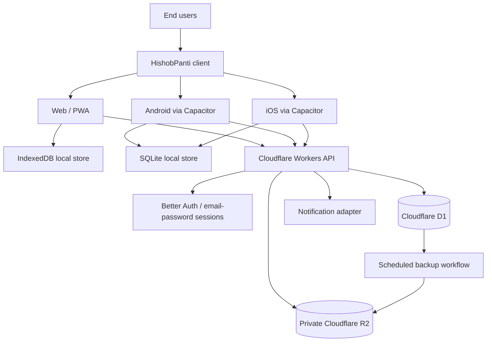
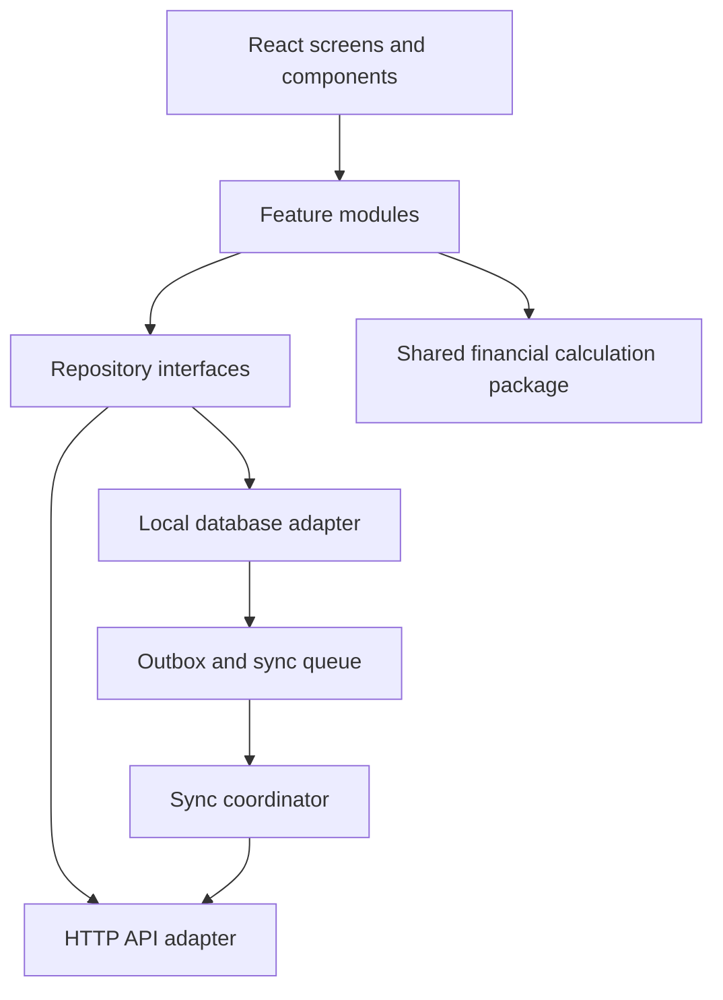

# 03 — System Architecture

**Product:** HishobPanti · **Version:** 1.0 · **Status:** Proposed production architecture

## 1. Architecture principles

1. Offline-first for expense capture; server-authoritative for shared records and settlements.
2. One TypeScript web codebase, packaged for Android and iOS with Capacitor.
3. Cloudflare is the production platform: Workers, D1 and R2.
4. Financial calculations are deterministic, integer-based and independently testable.
5. Every write is authenticated, authorized, validated and idempotent.
6. Local-only records are clearly distinguished from server-synchronized records.
7. Suggestions, payment claims and confirmed settlements are separate concepts.
8. Avoid premature microservices. Start with a modular monolith.

## 2. Logical system context

## 3. Runtime and technology choices

| Layer | Technology | Responsibility |
|---|---|---|
| Development workspace | Google AI Studio Build mode | Generate and iterate on source code |
| Client | React + TypeScript + Vite | Shared UI and client logic |
| Mobile wrapper | Capacitor | Package web app for Android/iOS and expose native plugins |
| Web local persistence | IndexedDB (Dexie or equivalent) | Cached records and pending outbox |
| Native local persistence | SQLite through a Capacitor plugin | Cached records and pending outbox |
| API | Cloudflare Workers + Hono | Authenticated application API |
| Authentication | Better Auth email/password | Registration, login, session, verification, reset |
| ORM/migrations | Drizzle ORM | Typed database access and migrations |
| Relational store | Cloudflare D1 | Authoritative shared records |
| Object store | Cloudflare R2 | Private receipt and export objects |
| Client cache | TanStack Query or equivalent | Remote query caching and invalidation |
| Local UI state | Zustand or React state | Transient UI state only |
| Validation | Zod or equivalent | Runtime input validation |

### AI Studio integration boundary

AI Studio is a development workspace, not the production database or the production source of truth. Generated code must be reviewed. The app client may be generated in AI Studio and synchronized/exported to GitHub. The production API must be implemented for the Cloudflare Workers runtime. Do not assume an AI Studio-generated Node.js server can be deployed to Workers unchanged. Keep server code portable and isolate platform-specific bindings.

## 4. Deployment topology

- Web frontend: static assets served through Cloudflare Workers Static Assets or an equivalent Cloudflare-supported deployment.
- API: Hono routes executed in Cloudflare Workers.
- Database: D1 binding available only to server code.
- Attachments: private R2 bucket accessed through server-authorized short-lived URLs or proxied endpoints.
- Scheduled recovery: scheduled Worker/Workflow exports D1 data to a separate private R2 backup location.
- Secrets: Cloudflare secrets/bindings, never Vite `VITE_*` variables or source-controlled files.

The web/PWA can be a first delivery target. Capacitor builds provide Android and iOS app packages. iOS signing/building still requires an Apple-compatible build environment and developer account where required.

## 5. Client modules

Feature modules: authentication, groups, invitations, expenses, splits, balances, settlements, budgets, activity, notifications, offline/sync, profile and settings.

Repository interfaces keep screens independent of whether data came from the local store or the remote API. Use local-first reads for previously synchronized records. Writes are persisted locally before network submission so the UI does not depend on an immediate connection.

## 6. Backend modules

Use one Worker application with clear modules:

- `auth`: Better Auth handler and session utilities.
- `users`: profile operations.
- `groups`: group lifecycle and membership.
- `invites`: code generation, redemption and revocation.
- `expenses`: expense lifecycle, splits and history.
- `finance`: split validation, net balances and settlement suggestions.
- `settlements`: payment claims, confirmation and rejection.
- `budgets`: group and category budget calculations.
- `uploads`: R2 signed URL issuance and object authorization.
- `sync`: idempotent offline operation ingestion.
- `notifications`: in-app event creation and delivery adapter.
- `audit`: append-only important activity events.

Keep finance functions pure where possible: inputs are records; outputs are integer amounts and deterministic results. The API applies authorization and persists results.

## 7. Core data ownership

| Data | Local client | D1 | R2 |
|---|---|---|---|
| Auth session | Secure session storage | Better Auth tables | — |
| Group/profile cache | Yes | Authoritative | Avatar objects if used |
| Expenses/splits | Cached + pending outbox | Authoritative after sync | — |
| Balances | Derived cache/provisional offline | Derived from records | — |
| Settlement suggestions | Cached snapshot | Run and suggestion records | — |
| Settlements | Cached | Authoritative status | — |
| Notes | Cached | Authoritative after sync | — |
| Receipt image | Pending upload reference | Metadata/object key | File bytes |
| Backups | Optional exported file | Source database | Backup objects |

## 8. Request lifecycle

1. Client attaches the authenticated session.
2. Worker resolves the user and session.
3. Route validates request schema.
4. Service checks group membership and role.
5. Service checks idempotency/version where applicable.
6. D1 writes related rows consistently.
7. Audit/notification events are recorded or queued.
8. API returns canonical records and server versions.
9. Client updates local cache and marks matching outbox operation acknowledged.

## 9. Trust and security boundaries

- The client is untrusted. Never trust client-supplied user IDs for the acting identity.
- Every group-scoped request checks membership on the server.
- Sender/receiver actions check exact settlement participants.
- D1 is never directly accessed by client code.
- R2 is private; object keys are not authorization.
- Signed URLs are short-lived and scoped to a specific object/action.
- Invite codes are secrets and must be hashed at rest.
- Secrets, auth signing keys and database bindings stay server-side.
- Local data can be exposed on a compromised/unlocked device; use native secure storage/encryption where available and explain platform limits.

## 10. Reliability and scale

Start with a single modular Worker and D1 database. Add indexes for group membership, expense timelines, member splits, settlements and outbox/idempotency lookup. Paginate large lists. Use batched writes for an expense plus its splits and use conditional state transitions for settlements. Monitor API error rate, D1 latency, failed sync operations and backup success. Revisit database topology only when measured scale or isolation requirements justify it.

## 11. Architecture decisions (ADRs)

| ADR | Decision | Reason |
|---|---|---|
| ADR-001 | React + TypeScript + Vite client | Shared UI across web and mobile wrapper |
| ADR-002 | Capacitor for Android/iOS | Reuse one client codebase |
| ADR-003 | Workers + Hono backend | Cloudflare-native API execution |
| ADR-004 | D1 for relational records | Group/expense/split/settlement relationships |
| ADR-005 | R2 for object storage | Receipt images and backup exports |
| ADR-006 | Local DB + outbox | Reliable offline expense capture |
| ADR-007 | Derived balances | Prevent independently editable balance drift |
| ADR-008 | Receiver-confirmed settlement | Sender alone cannot clear a debt |

## 12. Open technical decisions

- Email delivery provider and sender domain.
- Specific Capacitor SQLite plugin and encryption configuration.
- Push notification provider and delivery behavior.
- Web/PWA launch scope and browser support matrix.
- Backup schedule, retention and recovery-point objective.
- D1 limits and measured workload before launch.
