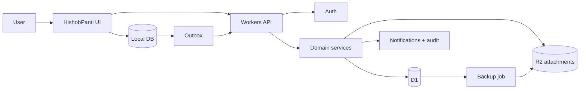
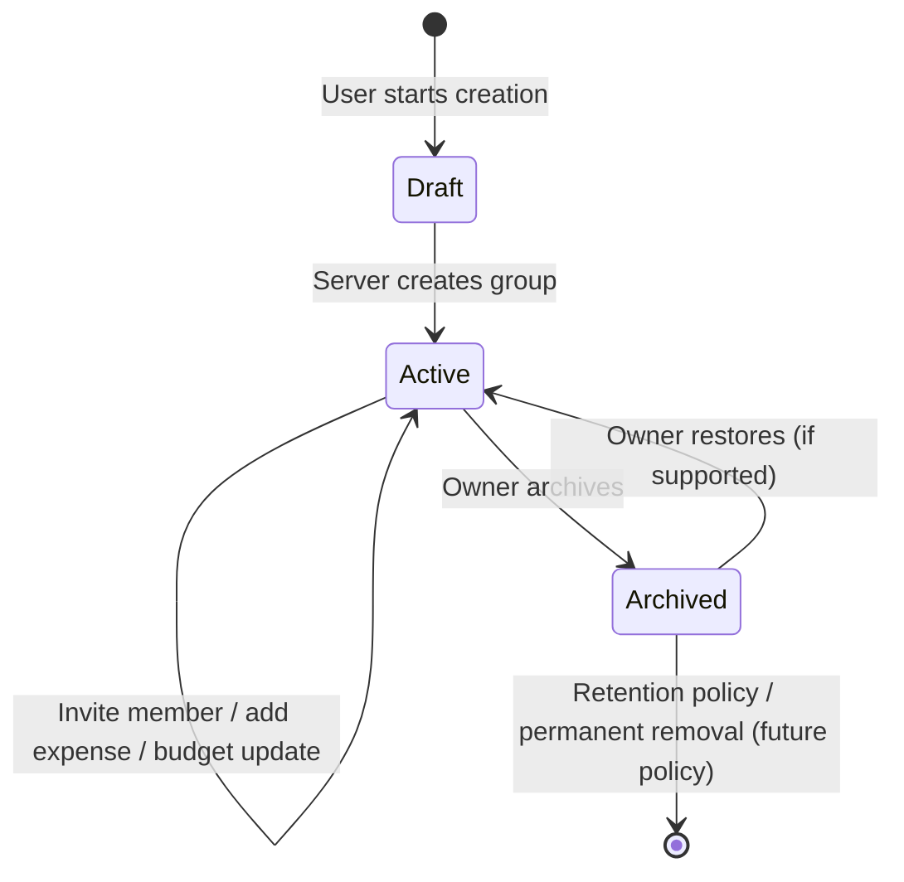
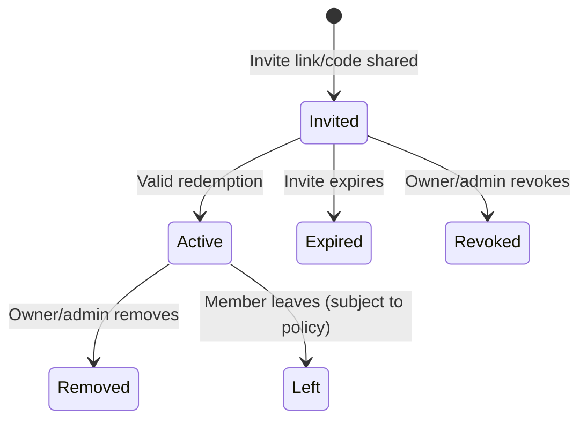
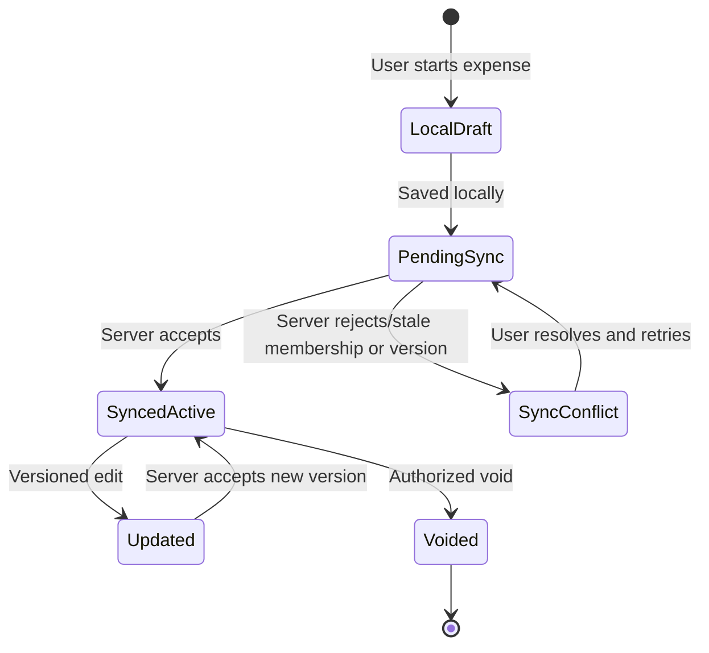
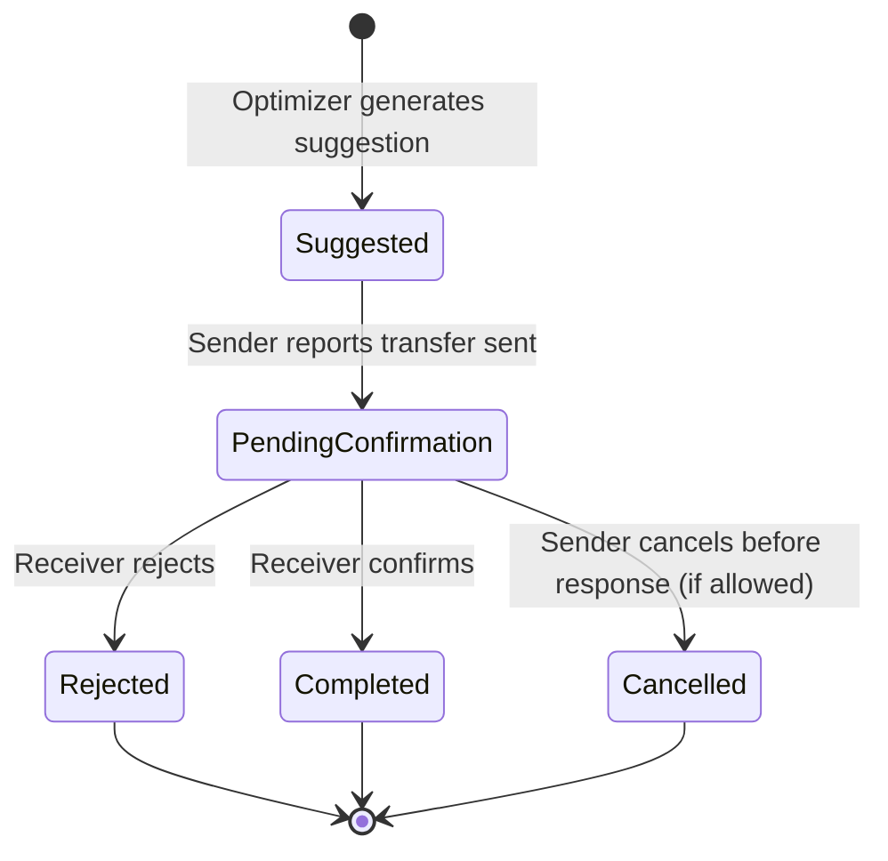

# 04 — System Mapping

**Product:** HishobPanti · **Version:** 1.0

This document maps user needs to screens, services, records and acceptance tests. It is intended to be the shared reference for design, frontend, backend and QA.

## 1. End-to-end context map

## 2. Screen-to-capability map

| Screen/page | Primary user action | Frontend module | API/service | Main records | Offline behavior |
|---|---|---|---|---|---|
| Splash | Open app | App shell | Session check | Auth session | Show cached shell |
| Signup | Create account | Auth | Better Auth | Auth user, profile | Online required |
| Login | Sign in | Auth | Better Auth | Session | Online required; valid cached session may show cache per policy |
| Verify email | Verify address | Auth | Better Auth/email provider | Verification | Online required |
| Forgot password | Reset password | Auth | Better Auth/email provider | Verification/session | Online required |
| Home | See groups and personal summary | Dashboard | Groups + balances query | Groups, memberships, derived balances | Cached snapshot; label stale/offline |
| Groups | Search and filter groups | Groups | Group list | Groups, memberships | Cached groups |
| Create group | Create new group | Groups | Group service | Groups, membership, invite | Save draft only offline; creation needs server |
| Group created/invite | Copy/share code | Invites | Invite service | Group invite | Existing code visible from cache only if retained and valid; redemption online |
| Join group | Enter invite code | Invites | Invite redemption | Invite, membership | Online required |
| Group overview | See spend/budget/activity | Group | Group summary | Group, expenses, budget | Cached/provisional |
| Expense list | Browse expenses | Expenses | Expense query | Expenses, splits | Cached list |
| Add expense | Record spending | Expense form | Expense create/sync | Expense, splits, outbox | Full offline capture for cached group/member set |
| Expense detail | Review title/note/splits | Expense detail | Expense detail/history | Expense, splits, activity | Cached detail |
| Edit/void expense | Correct record | Expense detail | Versioned mutation | Expense, splits, activity | Queue edit if supported; conflict resolution required |
| Split preview | Validate allocation | Split editor | Shared financial package | Split draft | Fully offline |
| Balances | See who owes whom | Balances | Balance service | Expenses, splits, completed settlements | Provisional from cached records |
| Settlement suggestions | Simplify debts | Settlement | Settlement optimizer | Run, suggestions | Show last cached run; recompute provisional only if clearly labelled |
| Payment detail | Sender marks paid | Settlement | Claim service | Settlement | Queue claim; not yet server-pending |
| Confirm received | Receiver confirms | Settlement inbox/detail | Settlement state transition | Settlement, activity | Online required |
| Reject payment | Receiver rejects | Settlement detail | Settlement state transition | Settlement, activity | Online required |
| Budget | Manage trip budget | Budget | Budget service | Group budget, category limits | Cached; local provisional expense usage |
| Insights | View spending trends | Insights | Aggregation service | Expenses/splits | Cached summary; may be stale |
| Notifications | Read alerts | Notifications | Notification service | Notifications | Cached notifications |
| Profile | Edit profile | Profile | User service | Profile | Local draft, sync later if desired |
| Settings | Security, currency, appearance | Settings | Auth/settings | User settings | Some settings local; security changes online |
| Sync center | Inspect pending/retry | Offline/sync | Sync service | Local outbox, sync state | Core offline screen |

## 3. Requirement-to-system mapping

| Requirement ID | UI entry point | Backend owner | Data touched | Key rule |
|---|---|---|---|---|
| AUTH-01/02 | Login/signup | Better Auth | Auth tables | No plaintext password storage |
| GROUP-01 | Create group | Groups | groups, group_members | Creator becomes owner |
| GROUP-02/03 | Invite/join | Invites | group_invites, group_members | Online validation; store invite hash |
| EXP-01 | Add expense | Expenses | expenses, expense_splits | Payer and participants must be members |
| EXP-02 | Split editor | Financial engine | expense_splits | Exact paise total |
| EXP-03 | Edit/void | Expenses | expenses, splits, activity_logs | Version check; no silent overwrite |
| BAL-01 | Balances | Financial engine | Expenses, splits, settlements | Only completed settlements included |
| SET-01 | Simplify | Settlement optimizer | settlement_runs, suggestions | Suggestion does not affect balance |
| SET-02 | Mark paid | Settlements | settlements | Sender only; pending confirmation after server accepts |
| SET-03/04 | Confirm/reject | Settlements | settlements, activity_logs | Only intended receiver can respond |
| BUD-01 | Group budget | Budgets | groups | Active expenses count; settlements do not |
| OFF-01/02 | Add expense offline | Local repository | local expenses/splits/outbox | Persist before network call |
| OFF-03/04 | Sync center | Sync | outbox, idempotency_keys | Retry safely; acknowledge only after server commit |
| SEC-01 | Every private route | Auth middleware | Membership/roles | Server-side authorization |
| SEC-02 | Receipt viewer | Uploads | attachment metadata + R2 | Private bucket and scoped URL |

## 4. Group lifecycle map

Membership lifecycle:

## 5. Expense lifecycle map

## 6. Settlement state map

Suggestions should be persisted separately from payment records. A generated suggestion never changes balances.

## 7. Core services and responsibilities

| Service | Owns | Must not own |
|---|---|---|
| Auth | Session identity and auth flows | Group financial calculations |
| Group | Group and member lifecycle | Client-local outbox |
| Invite | Code lifecycle/redemption | Authentication credentials |
| Expense | Expense and split writes | Manually edited balances |
| Financial engine | Split math and net position calculation | Payment confirmation state |
| Settlement | Suggestions and payment state transitions | Initiating real money transfer |
| Budget | Spend/remaining calculations | Repayment totals as spending |
| Sync | Idempotent queued operations | Bypassing domain authorization |
| Upload | Signed R2 access | Public bucket access |
| Audit/notification | Activity and member alerts | Authoritative financial totals |

## 8. Cross-cutting invariants

- All money is integer paise.
- Expense split sum equals expense total.
- Group net balances sum to zero.
- Suggestions do not alter balances.
- Sender claims do not alter balances.
- Receiver-confirmed settlements alter balances once.
- Budget spending is active expense total, not settlements.
- Unsynced local expense is not visible to other members.
- Nonmembers cannot read group records or attachments.
- Server state wins for synchronized shared records; local conflict copies are preserved for resolution.

## 9. Release traceability checklist

A release is not accepted solely because each page renders. Every P0 requirement must have:

1. A screen or supported user interaction.
2. A service/API or explicitly local behavior.
3. A persisted record or deterministic derived result.
4. Authorization and validation coverage.
5. An automated test and a manual end-to-end test.
6. Correct offline/sync behavior where applicable.
