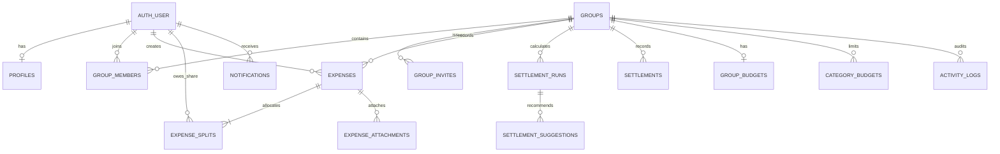

# 05 — Data Model and D1 Schema

**Product:** HishobPanti · **Version:** 1.0 · **Database:** Cloudflare D1 (SQLite)

This is a logical schema and starter migration. Review it against the exact Better Auth and Drizzle versions selected during implementation before deploying. Better Auth owns its generated authentication tables and migrations; do not hand-roll password/session tables alongside it.

## 1. Data modeling rules

- Primary IDs are opaque UUIDs generated by the client or server; client-generated IDs allow offline expense creation.
- All money is stored as `INTEGER` paise. Never store money as `REAL`.
- Timestamps are UTC ISO-8601 strings or integer epoch values; choose one convention and use it consistently. This draft uses UTC ISO-8601 text.
- Foreign keys are enabled for every connection.
- Soft voiding preserves financial history.
- `version` supports optimistic concurrency.
- Sensitive invitation codes are stored as hashes, never raw values.
- Better Auth user IDs are the canonical identity referenced by application tables.

## 2. Entity relationship map



`AUTH_USER` represents the Better Auth user table, not an application-defined replacement.

## 3. Core tables

### `profiles`

| Column | Type | Rules |
|---|---|---|
| `user_id` | TEXT | PK; references Better Auth user ID |
| `display_name` | TEXT | Required, bounded length |
| `avatar_object_key` | TEXT | Nullable R2 key |
| `created_at` | TEXT | Required UTC timestamp |
| `updated_at` | TEXT | Required UTC timestamp |

### `groups`

| Column | Type | Rules |
|---|---|---|
| `id` | TEXT | PK |
| `name` | TEXT | Required |
| `group_type` | TEXT | trip, dining, food, college, household, event, other |
| `description` | TEXT | Nullable |
| `currency_code` | TEXT | ISO-style code; MVP defaults INR |
| `start_date` / `end_date` | TEXT | Nullable date values |
| `budget_total_paise` | INTEGER | Nullable, non-negative |
| `created_by` | TEXT | FK to Better Auth user |
| `status` | TEXT | active or archived |
| `created_at` / `updated_at` | TEXT | Required |

### `group_members`

| Column | Type | Rules |
|---|---|---|
| `id` | TEXT | PK |
| `group_id` | TEXT | FK groups |
| `user_id` | TEXT | FK Better Auth user |
| `role` | TEXT | owner, admin, member |
| `status` | TEXT | active, removed, left |
| `joined_at` | TEXT | Required |
| `UNIQUE(group_id,user_id)` | — | Prevent duplicate membership |

### `group_invites`

| Column | Type | Rules |
|---|---|---|
| `id` | TEXT | PK |
| `group_id` | TEXT | FK groups |
| `code_hash` | TEXT | Unique; hash of high-entropy invite token |
| `created_by` | TEXT | FK Better Auth user |
| `expires_at` | TEXT | Required |
| `max_uses` | INTEGER | Nullable or positive |
| `used_count` | INTEGER | Non-negative, default 0 |
| `revoked_at` | TEXT | Nullable |
| `created_at` | TEXT | Required |

### `categories`

| Column | Type | Rules |
|---|---|---|
| `id` | TEXT | PK |
| `name` | TEXT | Required |
| `icon_key` | TEXT | Optional design token/icon name |
| `is_system` | INTEGER | Boolean 0/1 |
| `created_at` | TEXT | Required |

### `expenses`

| Column | Type | Rules |
|---|---|---|
| `id` | TEXT | PK; client-generated UUID supported |
| `group_id` | TEXT | FK groups |
| `title` | TEXT | Required |
| `note` | TEXT | Optional, bounded e.g. 500 chars |
| `total_paise` | INTEGER | Positive integer |
| `paid_by_user_id` | TEXT | FK user; must be active group member at validation time |
| `created_by_user_id` | TEXT | FK user |
| `category_id` | TEXT | Nullable FK categories |
| `split_method` | TEXT | equal, exact, percentage, shares |
| `occurred_at` | TEXT | Required timestamp |
| `status` | TEXT | active, voided |
| `version` | INTEGER | Positive; optimistic concurrency |
| `client_created_at` | TEXT | Optional client timestamp for audit/display |
| `created_at` / `updated_at` | TEXT | Server timestamps |

### `expense_splits`

| Column | Type | Rules |
|---|---|---|
| `id` | TEXT | PK |
| `expense_id` | TEXT | FK expenses |
| `user_id` | TEXT | FK user; group member at expense validation |
| `amount_paise` | INTEGER | Non-negative integer |
| `shares` | INTEGER | Nullable positive integer for shares method |
| `percentage_bps` | INTEGER | Nullable 0–10000 basis points |
| `UNIQUE(expense_id,user_id)` | — | One split row per participant |

### `settlement_runs`

| Column | Type | Rules |
|---|---|---|
| `id` | TEXT | PK |
| `group_id` | TEXT | FK groups |
| `created_by` | TEXT | FK user |
| `algorithm_version` | TEXT | Required |
| `balance_snapshot_json` | TEXT | Validated snapshot for explanation/audit |
| `created_at` | TEXT | Required |

### `settlement_suggestions`

| Column | Type | Rules |
|---|---|---|
| `id` | TEXT | PK |
| `run_id` | TEXT | FK settlement_runs |
| `from_user_id` | TEXT | FK user |
| `to_user_id` | TEXT | FK user; different from sender |
| `amount_paise` | INTEGER | Positive integer |
| `created_at` | TEXT | Required |

Suggestions are not payment records and do not affect balances.

### `settlements`

| Column | Type | Rules |
|---|---|---|
| `id` | TEXT | PK |
| `group_id` | TEXT | FK groups |
| `from_user_id` | TEXT | FK user |
| `to_user_id` | TEXT | FK user; must differ |
| `amount_paise` | INTEGER | Positive integer |
| `status` | TEXT | pending_confirmation, completed, rejected, cancelled |
| `payment_method` | TEXT | Optional label, e.g. UPI/cash/bank |
| `payment_reference` | TEXT | Optional user-entered reference; do not treat as verification |
| `sender_note` | TEXT | Optional |
| `paid_at` | TEXT | Nullable sender claim timestamp |
| `confirmed_at` | TEXT | Nullable receiver confirmation timestamp |
| `rejected_at` | TEXT | Nullable receiver rejection timestamp |
| `created_at` / `updated_at` | TEXT | Required |
| `version` | INTEGER | Optimistic concurrency |

### `expense_attachments`

| Column | Type | Rules |
|---|---|---|
| `id` | TEXT | PK |
| `expense_id` | TEXT | FK expenses |
| `uploaded_by` | TEXT | FK user |
| `r2_object_key` | TEXT | Private object key |
| `mime_type` | TEXT | Allow-listed MIME type |
| `size_bytes` | INTEGER | Positive and within configured limit |
| `created_at` | TEXT | Required |

### `group_budgets` and `category_budgets`

`group_budgets`: `id`, `group_id` (unique), `amount_paise`, `created_by`, `updated_at`.

`category_budgets`: `id`, `group_id`, `category_id`, `amount_paise`, `period_start`, `period_end`, timestamps. Category budgets can be P1 even if table is created in the initial migration.

### `activity_logs`

`id`, `group_id`, `actor_user_id`, `entity_type`, `entity_id`, `action`, `before_json`, `after_json`, `created_at`. Avoid storing secrets or full receipt contents. Restrict write access to server code.

### `notifications`

`id`, `user_id`, `group_id`, `type`, `payload_json`, `read_at`, `created_at`. Payload should contain IDs and concise display details, not sensitive secrets.

### `idempotency_keys`

`key`, `user_id`, `request_hash`, `response_json` or `resource_id`, `created_at`, `expires_at`. Unique scope should include user and operation/route to prevent collisions.

## 4. Starter SQL migration

This starter SQL omits Better Auth-owned migrations. Use it as a reviewed base, not as a substitute for generated Auth migrations.

```sql
PRAGMA foreign_keys = ON;

CREATE TABLE IF NOT EXISTS profiles (
  user_id TEXT PRIMARY KEY,
  display_name TEXT NOT NULL CHECK(length(display_name) BETWEEN 1 AND 80),
  avatar_object_key TEXT,
  created_at TEXT NOT NULL,
  updated_at TEXT NOT NULL,
  FOREIGN KEY(user_id) REFERENCES user(id) ON DELETE CASCADE
);

CREATE TABLE IF NOT EXISTS groups (
  id TEXT PRIMARY KEY,
  name TEXT NOT NULL CHECK(length(name) BETWEEN 1 AND 100),
  group_type TEXT NOT NULL CHECK(group_type IN ('trip','dining','food','college','household','event','other')),
  description TEXT,
  currency_code TEXT NOT NULL DEFAULT 'INR',
  start_date TEXT,
  end_date TEXT,
  budget_total_paise INTEGER CHECK(budget_total_paise IS NULL OR budget_total_paise >= 0),
  created_by TEXT NOT NULL,
  status TEXT NOT NULL DEFAULT 'active' CHECK(status IN ('active','archived')),
  created_at TEXT NOT NULL,
  updated_at TEXT NOT NULL,
  FOREIGN KEY(created_by) REFERENCES user(id)
);

CREATE TABLE IF NOT EXISTS group_members (
  id TEXT PRIMARY KEY,
  group_id TEXT NOT NULL,
  user_id TEXT NOT NULL,
  role TEXT NOT NULL DEFAULT 'member' CHECK(role IN ('owner','admin','member')),
  status TEXT NOT NULL DEFAULT 'active' CHECK(status IN ('active','removed','left')),
  joined_at TEXT NOT NULL,
  UNIQUE(group_id, user_id),
  FOREIGN KEY(group_id) REFERENCES groups(id),
  FOREIGN KEY(user_id) REFERENCES user(id)
);

CREATE TABLE IF NOT EXISTS group_invites (
  id TEXT PRIMARY KEY,
  group_id TEXT NOT NULL,
  code_hash TEXT NOT NULL UNIQUE,
  created_by TEXT NOT NULL,
  expires_at TEXT NOT NULL,
  max_uses INTEGER CHECK(max_uses IS NULL OR max_uses > 0),
  used_count INTEGER NOT NULL DEFAULT 0 CHECK(used_count >= 0),
  revoked_at TEXT,
  created_at TEXT NOT NULL,
  FOREIGN KEY(group_id) REFERENCES groups(id),
  FOREIGN KEY(created_by) REFERENCES user(id)
);

CREATE TABLE IF NOT EXISTS categories (
  id TEXT PRIMARY KEY,
  name TEXT NOT NULL,
  icon_key TEXT,
  is_system INTEGER NOT NULL DEFAULT 1 CHECK(is_system IN (0,1)),
  created_at TEXT NOT NULL
);

CREATE TABLE IF NOT EXISTS expenses (
  id TEXT PRIMARY KEY,
  group_id TEXT NOT NULL,
  title TEXT NOT NULL CHECK(length(title) BETWEEN 1 AND 120),
  note TEXT CHECK(note IS NULL OR length(note) <= 500),
  total_paise INTEGER NOT NULL CHECK(total_paise > 0),
  paid_by_user_id TEXT NOT NULL,
  created_by_user_id TEXT NOT NULL,
  category_id TEXT,
  split_method TEXT NOT NULL CHECK(split_method IN ('equal','exact','percentage','shares')),
  occurred_at TEXT NOT NULL,
  status TEXT NOT NULL DEFAULT 'active' CHECK(status IN ('active','voided')),
  version INTEGER NOT NULL DEFAULT 1 CHECK(version > 0),
  client_created_at TEXT,
  created_at TEXT NOT NULL,
  updated_at TEXT NOT NULL,
  FOREIGN KEY(group_id) REFERENCES groups(id),
  FOREIGN KEY(paid_by_user_id) REFERENCES user(id),
  FOREIGN KEY(created_by_user_id) REFERENCES user(id),
  FOREIGN KEY(category_id) REFERENCES categories(id)
);

CREATE TABLE IF NOT EXISTS expense_splits (
  id TEXT PRIMARY KEY,
  expense_id TEXT NOT NULL,
  user_id TEXT NOT NULL,
  amount_paise INTEGER NOT NULL CHECK(amount_paise >= 0),
  shares INTEGER CHECK(shares IS NULL OR shares > 0),
  percentage_bps INTEGER CHECK(percentage_bps IS NULL OR percentage_bps BETWEEN 0 AND 10000),
  UNIQUE(expense_id, user_id),
  FOREIGN KEY(expense_id) REFERENCES expenses(id),
  FOREIGN KEY(user_id) REFERENCES user(id)
);

CREATE TABLE IF NOT EXISTS settlement_runs (
  id TEXT PRIMARY KEY,
  group_id TEXT NOT NULL,
  created_by TEXT NOT NULL,
  algorithm_version TEXT NOT NULL,
  balance_snapshot_json TEXT NOT NULL,
  created_at TEXT NOT NULL,
  FOREIGN KEY(group_id) REFERENCES groups(id),
  FOREIGN KEY(created_by) REFERENCES user(id)
);

CREATE TABLE IF NOT EXISTS settlement_suggestions (
  id TEXT PRIMARY KEY,
  run_id TEXT NOT NULL,
  from_user_id TEXT NOT NULL,
  to_user_id TEXT NOT NULL,
  amount_paise INTEGER NOT NULL CHECK(amount_paise > 0),
  created_at TEXT NOT NULL,
  CHECK(from_user_id <> to_user_id),
  FOREIGN KEY(run_id) REFERENCES settlement_runs(id),
  FOREIGN KEY(from_user_id) REFERENCES user(id),
  FOREIGN KEY(to_user_id) REFERENCES user(id)
);

CREATE TABLE IF NOT EXISTS settlements (
  id TEXT PRIMARY KEY,
  group_id TEXT NOT NULL,
  from_user_id TEXT NOT NULL,
  to_user_id TEXT NOT NULL,
  amount_paise INTEGER NOT NULL CHECK(amount_paise > 0),
  status TEXT NOT NULL CHECK(status IN ('pending_confirmation','completed','rejected','cancelled')),
  payment_method TEXT,
  payment_reference TEXT,
  sender_note TEXT,
  paid_at TEXT,
  confirmed_at TEXT,
  rejected_at TEXT,
  version INTEGER NOT NULL DEFAULT 1 CHECK(version > 0),
  created_at TEXT NOT NULL,
  updated_at TEXT NOT NULL,
  CHECK(from_user_id <> to_user_id),
  FOREIGN KEY(group_id) REFERENCES groups(id),
  FOREIGN KEY(from_user_id) REFERENCES user(id),
  FOREIGN KEY(to_user_id) REFERENCES user(id)
);

CREATE TABLE IF NOT EXISTS expense_attachments (
  id TEXT PRIMARY KEY,
  expense_id TEXT NOT NULL,
  uploaded_by TEXT NOT NULL,
  r2_object_key TEXT NOT NULL UNIQUE,
  mime_type TEXT NOT NULL,
  size_bytes INTEGER NOT NULL CHECK(size_bytes > 0),
  created_at TEXT NOT NULL,
  FOREIGN KEY(expense_id) REFERENCES expenses(id),
  FOREIGN KEY(uploaded_by) REFERENCES user(id)
);

CREATE TABLE IF NOT EXISTS category_budgets (
  id TEXT PRIMARY KEY,
  group_id TEXT NOT NULL,
  category_id TEXT NOT NULL,
  amount_paise INTEGER NOT NULL CHECK(amount_paise >= 0),
  period_start TEXT,
  period_end TEXT,
  created_at TEXT NOT NULL,
  updated_at TEXT NOT NULL,
  FOREIGN KEY(group_id) REFERENCES groups(id),
  FOREIGN KEY(category_id) REFERENCES categories(id)
);

CREATE TABLE IF NOT EXISTS activity_logs (
  id TEXT PRIMARY KEY,
  group_id TEXT NOT NULL,
  actor_user_id TEXT NOT NULL,
  entity_type TEXT NOT NULL,
  entity_id TEXT NOT NULL,
  action TEXT NOT NULL,
  before_json TEXT,
  after_json TEXT,
  created_at TEXT NOT NULL,
  FOREIGN KEY(group_id) REFERENCES groups(id),
  FOREIGN KEY(actor_user_id) REFERENCES user(id)
);

CREATE TABLE IF NOT EXISTS notifications (
  id TEXT PRIMARY KEY,
  user_id TEXT NOT NULL,
  group_id TEXT,
  type TEXT NOT NULL,
  payload_json TEXT NOT NULL,
  read_at TEXT,
  created_at TEXT NOT NULL,
  FOREIGN KEY(user_id) REFERENCES user(id),
  FOREIGN KEY(group_id) REFERENCES groups(id)
);

CREATE TABLE IF NOT EXISTS idempotency_keys (
  user_id TEXT NOT NULL,
  scope TEXT NOT NULL,
  key TEXT NOT NULL,
  request_hash TEXT NOT NULL,
  resource_id TEXT,
  response_json TEXT,
  created_at TEXT NOT NULL,
  expires_at TEXT,
  PRIMARY KEY(user_id, scope, key),
  FOREIGN KEY(user_id) REFERENCES user(id)
);

CREATE INDEX IF NOT EXISTS idx_group_members_user ON group_members(user_id, status);
CREATE INDEX IF NOT EXISTS idx_expenses_group_date ON expenses(group_id, occurred_at DESC, status);
CREATE INDEX IF NOT EXISTS idx_expense_splits_user ON expense_splits(user_id, expense_id);
CREATE INDEX IF NOT EXISTS idx_settlements_group_status ON settlements(group_id, status, created_at DESC);
CREATE INDEX IF NOT EXISTS idx_settlements_receiver ON settlements(to_user_id, status, created_at DESC);
CREATE INDEX IF NOT EXISTS idx_invites_hash ON group_invites(code_hash);
CREATE INDEX IF NOT EXISTS idx_activity_group_date ON activity_logs(group_id, created_at DESC);
CREATE INDEX IF NOT EXISTS idx_notifications_user_date ON notifications(user_id, created_at DESC);
```

**Migration note:** In the final Drizzle migration, ensure the Better Auth `user` table name and ID type match the generated schema. If the generated table differs, adjust all references before applying. Add trigger-level or transactional application checks for split sum and member eligibility; ordinary row-level `CHECK` constraints cannot validate aggregate totals across split rows.

## 5. Financial integrity constraints not expressible as simple CHECKs

Validate in a single server transaction/batch:

- `SUM(expense_splits.amount_paise) = expenses.total_paise`.
- Payer and split participants are active members of the same group.
- Percentage basis points sum to 10,000 where method is percentage.
- Settlement sender and receiver are active group members.
- Receiver confirmation is a compare-and-set transition from pending to completed.
- Only one completion transition can apply to a settlement.
- A voided expense is excluded from all derived balances and budget totals.

## 6. Data retention and deletion questions

Do not hard-delete a group or expense without an agreed retention policy. Account deletion must define treatment of historical group records: anonymize the profile, transfer ownership, or remove data where legally and product-wise appropriate. This decision is open and must be finalized before public launch.
