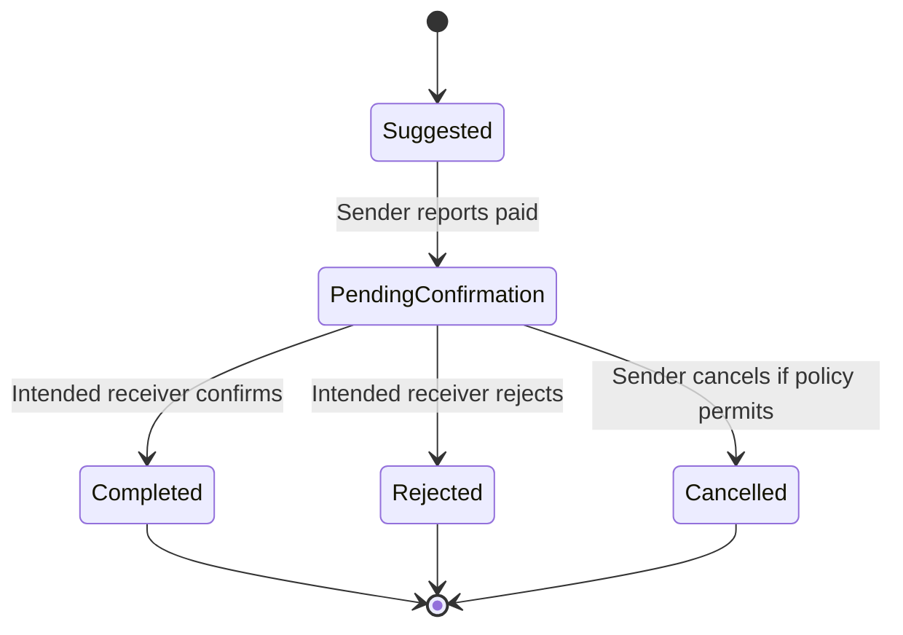

# 07 — Financial Engine

**Product:** HishobPanti · **Version:** 1.0 · **Critical domain module**

## 1. Rules that must never change silently

1. Store all amounts as integer paise.
2. Never use binary floating point for money.
3. Expense splits must sum exactly to expense total.
4. Group net positions must sum to zero.
5. Only active expenses count toward spending/budget.
6. Settlement suggestions are not payments.
7. Sender payment claims do not clear debt.
8. Only receiver-confirmed settlements clear balances.
9. A settlement must affect balances once, even if requests retry.
10. Every result is deterministic for the same canonical records.

## 2. Expense share calculation

For each expense `e`:

- `T(e)` = total amount in paise.
- `P(e)` = user who paid.
- `S(e,u)` = user's allocated share in paise.

Required invariant:

`SUM_u S(e,u) = T(e)`

Shares are non-negative integers. A zero share should normally be omitted rather than stored unless the UI needs an explicit zero participant.

### Equal split

For `n` participants:

- `base = floor(total / n)`.
- `remainder = total % n`.
- Allocate `base + 1` paise to the first `remainder` participants in a stable order; allocate `base` to the rest.

Stable order should be a deterministic ID sort or explicit participant order saved with the draft. Do not depend on unstable object iteration.

Example: ₹100 = 10,000 paise / 3 → 3,334, 3,333, 3,333 paise.

### Exact/custom split

User enters integer paise amounts. Validate the sum equals the total exactly. Do not silently normalize user-entered amounts.

### Percentage split

Store percentages as integer basis points (`10,000 bps = 100%`). Validate the total equals 10,000. Convert to provisional paise using integer multiplication/division, then distribute leftover paise deterministically so final shares sum exactly to total.

### Share-based split

Each participant has a positive integer weight `w_i`. Let `W = SUM(w_i)`. Calculate floor allocations using integer arithmetic; distribute leftover paise by largest fractional remainder, with stable user-ID tie breaking. Save final paise amounts and weights.

## 3. Balance derivation

For user `u` in group `g`:

`Net(u) = PaidActiveExpenses(u) - AllocatedActiveShares(u) + ConfirmedSettlementsSent(u) - ConfirmedSettlementsReceived(u)`

Interpretation:

- `Net(u) > 0`: group owes this user; user should receive.
- `Net(u) < 0`: user owes the group; user should pay.
- `Net(u) = 0`: settled.

Why settlement signs work: if A sends money to B, A's position improves by the amount (less debt/more credit) and B's position decreases by that amount. This removes the prior imbalance while preserving group total zero.

Group invariant:

`SUM_u Net(u) = 0`

Calculate from active expenses, their splits, and completed settlements only. Pending confirmation, rejected, cancelled and suggested transfers are excluded.

## 4. Worked example: circular debts

Given obligations:

- Y owes X ₹400.
- Z owes Y ₹300.
- X owes Z ₹500.

These are equivalent to net positions:

| User | Net position |
|---|---:|
| X | -₹100 |
| Y | -₹100 |
| Z | +₹200 |
| Total | ₹0 |

The direct simplified transfers are:

- X pays Z ₹100.
- Y pays Z ₹100.

The previous obligations may have originated from separate expense records. The optimizer uses net positions; it does not rewrite original expense history.

## 5. Settlement simplification algorithm

Input: canonical net balances for all active group members.

1. Validate the sum of all balances is zero.
2. Build debtor entries from negative balances (absolute value) and creditor entries from positive balances.
3. Sort both lists deterministically, e.g. descending amount and stable user-ID tie breaker.
4. Match the first debtor with the first creditor.
5. Emit a transfer equal to the smaller remaining amount.
6. Reduce both remaining amounts and advance any zeroed side.
7. Repeat until no debtor/creditor remains.
8. Validate suggested transfer totals equal total debtor amount and all simulated final balances reach zero.

Pseudocode:

```ts
type Balance = { userId: string; netPaise: number };
type Transfer = { fromUserId: string; toUserId: string; amountPaise: number };

function simplify(balances: Balance[]): Transfer[] {
  // Validate safe integer values and sum === 0 first.
  const debtors = balances
    .filter(x => x.netPaise < 0)
    .map(x => ({ userId: x.userId, remaining: -x.netPaise }))
    .sort((a, b) => b.remaining - a.remaining || a.userId.localeCompare(b.userId));

  const creditors = balances
    .filter(x => x.netPaise > 0)
    .map(x => ({ userId: x.userId, remaining: x.netPaise }))
    .sort((a, b) => b.remaining - a.remaining || a.userId.localeCompare(b.userId));

  const result: Transfer[] = [];
  let i = 0, j = 0;
  while (i < debtors.length && j < creditors.length) {
    const amountPaise = Math.min(debtors[i].remaining, creditors[j].remaining);
    if (amountPaise > 0) {
      result.push({
        fromUserId: debtors[i].userId,
        toUserId: creditors[j].userId,
        amountPaise
      });
    }
    debtors[i].remaining -= amountPaise;
    creditors[j].remaining -= amountPaise;
    if (debtors[i].remaining === 0) i++;
    if (creditors[j].remaining === 0) j++;
  }
  if (i !== debtors.length || j !== creditors.length) {
    throw new Error("Unbalanced input: cannot settle all balances");
  }
  return result;
}
```

This deterministic greedy algorithm simplifies transfers. It is not guaranteed to achieve the mathematical minimum number of transactions for every possible set of balances. Do not market it as a globally optimal solver unless a separate exact optimizer is implemented and tested.

## 6. Suggestion is not a payment

A settlement run stores a snapshot and recommended transfers. The user chooses a transfer and may later report that an external transfer was sent. Suggestion creation must not update a user's balance or create a completed settlement.

## 7. Two-sided payment state machine



### Allowed transitions

| From | To | Actor | Balance effect |
|---|---|---|---|
| Suggested | Pending confirmation | Sender | None |
| Pending confirmation | Completed | Intended receiver | Apply once |
| Pending confirmation | Rejected | Intended receiver | None |
| Pending confirmation | Cancelled | Sender, only under policy | None |

A payment marked by the sender offline remains a local queued command until the server acknowledges it. UI label: “Payment claim waiting to sync.” After server acknowledgment: “Awaiting receiver confirmation.” Only after receiver confirmation: “Payment confirmed.”

## 8. Partial payments

MVP should support a settlement claim for a specific amount up to the outstanding amount between the two members under the current net position snapshot. If partial payments are allowed, the remaining balance must stay outstanding after confirmation. Server validates that the transfer does not over-settle the current directed obligation. If a group has multiple offsetting debts, calculate current group net positions rather than blindly matching old pairwise expense rows.

## 9. Edit and void effects

Changing an active expense requires recalculating splits, payer contribution and balances. Voiding removes that expense from derived balances and budget usage while retaining its audit trail. The update must be atomic and version-checked. Any settlement suggestion based on an earlier balance snapshot should be marked stale and recomputed.

## 10. Numeric safety

- Validate `Number.isSafeInteger` in TypeScript or use bigint where ranges demand it.
- Database columns use integer types.
- Convert rupees to paise by parsing decimal strings, not multiplying arbitrary floating-point values.
- Format paise for display only at presentation time.
- Test boundary values and rounding ties.
- Reject negative, NaN, infinite and excessively large amounts.

## 11. Required automated tests

- Equal split: 10000 paise / 3 = 3334, 3333, 3333.
- Equal split: 10001 paise / 4 sums exactly to 10001.
- Exact split rejects mismatch by one paise.
- Percentage basis points must total 10000.
- Shares allocation totals original amount for many weights.
- Payer included as participant works.
- Payer not included as participant works.
- Voided expense is excluded.
- Pending settlement is excluded.
- Rejected settlement is excluded.
- Completed settlement changes balances once.
- Duplicate confirmation does not double apply.
- Group net balances always sum to zero.
- Circular-debt example yields X→Z ₹100 and Y→Z ₹100.
- Optimizer output transfers sum to total debtor amount.
- Invalid unbalanced net inputs fail loudly.
